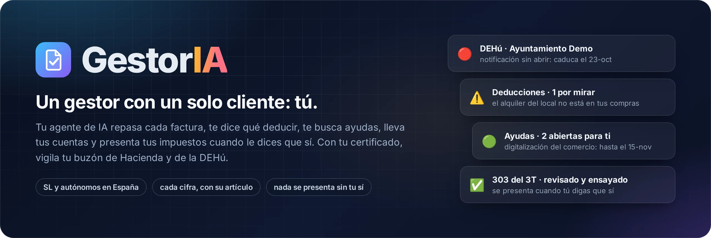
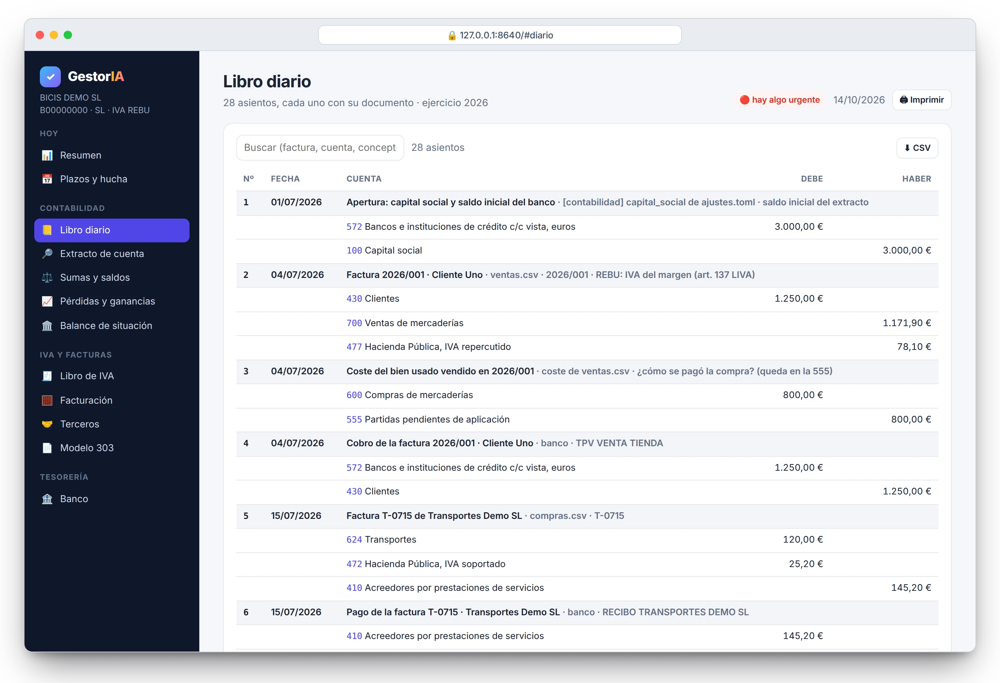
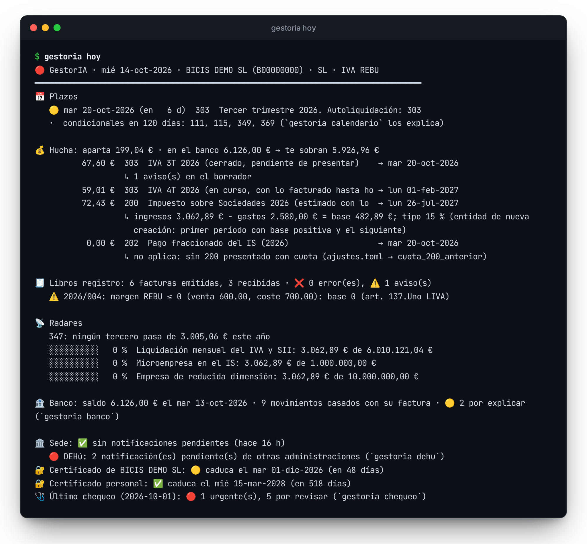
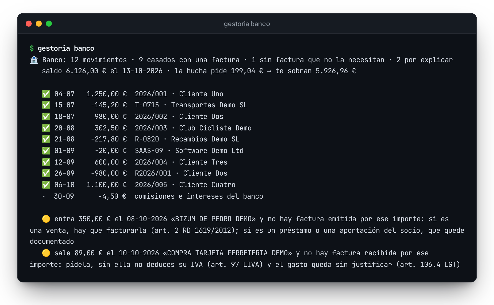
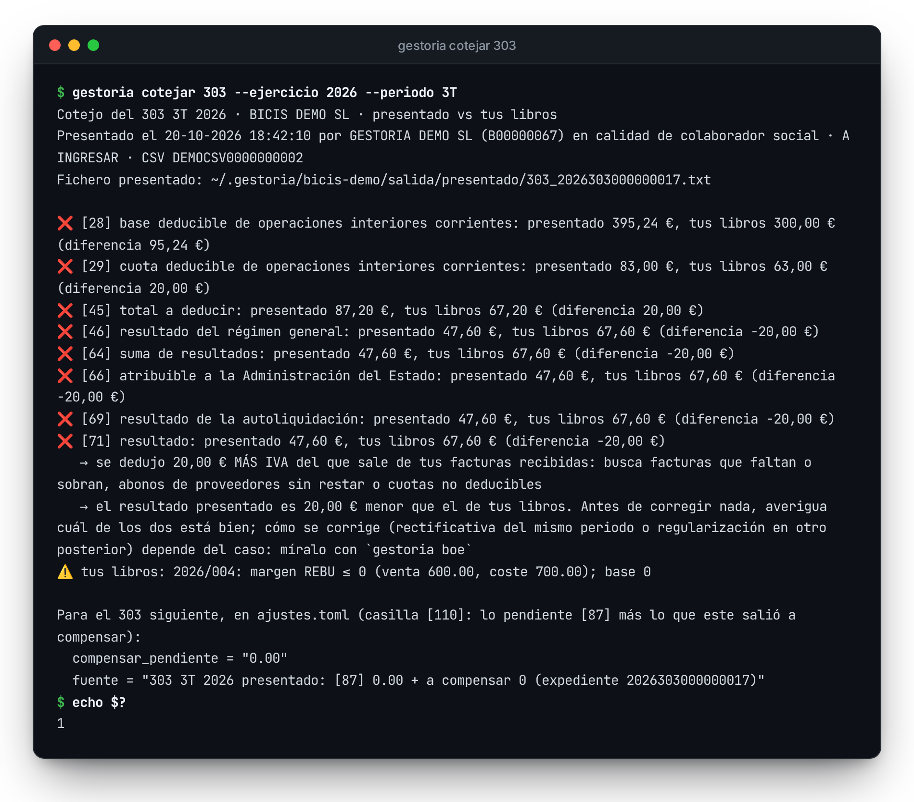
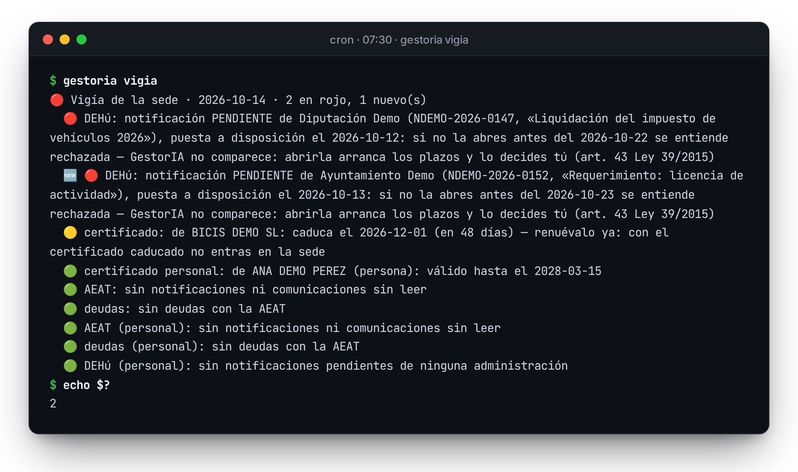
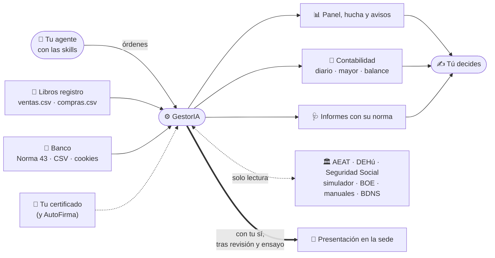

<p align="center">
  
</p>

<p align="center">
  
  
  
  
  
  
</p>

<p align="center">
  <a href="#tus-cuentas-en-el-navegador"><b>Tu panel</b></a> ·
  <a href="#qué-hace-por-ti"><b>Qué hace</b></a> ·
  <a href="#instálalo-con-tu-agente"><b>Instalar</b></a> ·
  <a href="#una-mañana-con-gestoria"><b>Una mañana</b></a> ·
  <a href="#lo-que-te-puedes-deducir"><b>Deducciones</b></a> ·
  <a href="#las-ayudas-que-salen-para-ti"><b>Ayudas</b></a> ·
  <a href="#el-iva-del-trimestre-de-principio-a-fin"><b>El IVA</b></a> ·
  <a href="#con-tu-certificado"><b>Certificado</b></a> ·
  <a href="#preguntas-frecuentes"><b>Preguntas</b></a>
</p>

**GestorIA es un gestor que trabaja en tu ordenador.** Le das tus facturas y los movimientos del
banco, y te lleva las cuentas, te dice cuánto tienes que guardar para Hacienda, qué gastos te puedes
desgravar y qué ayudas hay para ti. Cuando toca presentar el IVA, lo prepara, lo revisa y lo
presenta, pero solo si tú le dices que sí.

Tu gestoría tiene 80 clientes y no puede mirar lo tuyo con lupa. GestorIA solo te tiene a ti.

Es para autónomos y empresas en España. Funciona con tu asistente de IA (Claude Code,
Codex…) o a mano, desde la terminal.

## Instálalo con tu agente

Abre Claude Code en la carpeta de tu proyecto (o en una vacía) y pega uno de estos dos mensajes. Tu
agente lo instala, lo prueba con la empresa de ejemplo y te prepara tu carpeta. Antes te pregunta lo
que necesita: si eres SL o autónomo, tu NIF, dónde estás y si tienes certificado digital. No se
inventa nada que no le digas.

**Con el panel**, para ver tus cuentas en el navegador:

```text
Instala GestorIA en este proyecto, con el panel web.
Clona https://github.com/guglia001/GestorIA en ~/GestorIA (si ya está, actualízalo), lee ~/GestorIA/INSTALAR.md y síguelo paso a paso.
Pregúntame lo que necesites de mi empresa y no te inventes ningún dato.
```

**Sin el panel**, solo con tu agente y la terminal:

```text
Instala GestorIA en este proyecto, sin el panel web.
Clona https://github.com/guglia001/GestorIA en ~/GestorIA (si ya está, actualízalo), lee ~/GestorIA/INSTALAR.md y síguelo paso a paso.
Pregúntame lo que necesites de mi empresa y no te inventes ningún dato.
```


## Tus cuentas, en el navegador


Con `gestoria web` ves tus cuentas en el navegador, como una página web: cuánto has facturado y
cobrado, cuánto has gastado, cómo vas de resultado y cuánto tienes que guardar para Hacienda. Si
quieres el detalle, también están el libro diario, el balance, el IVA de cada trimestre, lo que le
has vendido a cada cliente y comprado a cada proveedor, y el banco.

Cada tabla se descarga en CSV, en el formato que abre bien el Excel en español, por si se la quieres
pasar a tu gestoría. Cada vista se imprime o se guarda en PDF, y en el móvil también se ve bien.



No tienes que meter ni un asiento. GestorIA los saca de tus documentos con el plan contable de
pymes, y cada uno dice de dónde viene: la factura, el movimiento del banco o la liquidación del
trimestre. Lo que no sabe explicar (un Bizum sin factura, un pago que no encaja) lo deja en la
cuenta 555, que existe para eso, y te lo pregunta. El IVA sale igual que en el 303 y el balance
cuadra al céntimo.

El panel corre en `127.0.0.1`, solo en tu ordenador, y no carga nada de internet. Si lo quieres en
un fichero, `gestoria web --fichero` te deja un único HTML. Si prefieres la terminal,
`gestoria contabilidad`.


## Qué hace por ti

- **Te enseña tus cuentas en el navegador:** lo que ganas, lo que gastas y lo que te toca pagar,
  sacado de tus facturas y de tu banco.
- **Cada mañana te dice qué vence y cuánto dinero tienes que tener guardado**, y para qué día.
- **Repasa qué te puedes deducir y qué no.** El seguro médico, una parte de la luz y el internet
  si trabajas en casa, las comidas, el coche, la reserva de capitalización de tu SL. Y lo que no
  deduce, para que no te lo tumbe Hacienda.
- **Te busca ayudas y subvenciones** de tu zona y de tu sector, y te dice cuáles siguen abiertas,
  hasta cuándo y dónde se piden.
- **Prepara el IVA del trimestre** (el 303), lo pasa por el simulador de Hacienda, lo ensaya en su
  entorno de pruebas y **lo presenta solo cuando le dices que sí**.
- **Vigila tu buzón.** Con tu certificado digital mira cada mañana si te ha llegado algo de
  Hacienda o de la DEHú, donde notifican Tráfico, tu ayuntamiento o la Seguridad Social. Sin
  abrirlo.
- **Revisa a tu gestoría**, si tienes: compara el 303 que te ha presentado con tus libros, casilla
  a casilla.

## Lo que no hace nunca

- **No mueve tu dinero.** No hace transferencias. Si una declaración sale a pagar, se domicilia en
  la propia declaración o la pagas tú.
- **No abre tus notificaciones.** Abrir una arranca los plazos, así que eso lo decides tú. GestorIA
  te dice cuántas hay, de quién son y cuándo caducan.
- **No presenta nada sin tu sí.** Antes tiene que pasar la revisión entera, ensayarlo en el entorno
  de pruebas de Hacienda y recibir tu conformidad, con una frase que solo vale para esa declaración.


Tus datos se quedan en `~/.gestoria/`, fuera de cualquier repositorio. Lo que hará el agente, paso
a paso, está en [`INSTALAR.md`](INSTALAR.md): léelo antes si quieres. Y si prefieres hacerlo tú,
[pruébalo a mano](#pruébalo-a-mano-en-5-minutos).

## Una mañana con GestorIA



Esto es `gestoria hoy` con la empresa de ejemplo, BICIS DEMO SL (una tienda inventada de bicis de
segunda mano), un 14 de octubre:

- el IVA del trimestre vence en 6 días;
- tienes que tener apartados 199,04 €, y en el banco hay 6.126,00 €;
- hay dos movimientos del banco sin factura;
- y tienes dos notificaciones esperando en la DEHú.

Los 199,04 € no son a ojo. Son el IVA del trimestre cerrado y el del que está en curso, el Impuesto
sobre Sociedades con el tipo que te toca (el 15 % si la empresa es nueva), los pagos fraccionados,
el 130 si eres autónomo y tu cuota de autónomos. Cada partida, con su fecha y su artículo
(`gestoria hucha`).

Arriba del todo, un semáforo:

- 🔴 si algo obligatorio vence en 3 días, si tienes una notificación sin abrir, una deuda o un error
  en los libros, o si el certificado caduca en 15 días;
- 🟡 si algo vence en 15 días, si hay avisos o movimientos sin explicar, si el certificado caduca en
  60 días o si el último chequeo dejó cosas pendientes;
- 🟢 si no hay nada de eso.

El semáforo también es el código de salida (2, 1 o 0), así que un cron o tu agente saben cuándo
tienen que avisarte.

## Lo que te puedes deducir


`gestoria deducciones` coge las reglas de la Ley del IRPF, la del IVA y la del Impuesto sobre
Sociedades y las cruza con tus facturas, tu banco y tu perfil. De cada una te dice una de estas
cuatro cosas:

- ✅ **ya la usas;**
- ⚠️ **parece que te la estás dejando, o te pasas del límite:** el seguro médico hasta 500 € por
  persona, las comidas hasta 26,67 € al día, el 30 % de los suministros de casa, el 1 % de la
  facturación en regalos e invitaciones a clientes…;
- ℹ️ **depende de un dato tuyo que los libros no llevan**, y te da la cifra estimada: la reducción
  del 20 % por empezar, la reserva de capitalización, el 5 % de gastos de difícil justificación;
- ⛔ **no deduce, aunque lo tengas apuntado:** multas, compras sin NIF, el IVA de una comida con un
  cliente.

Cada regla lleva su artículo. Con `--comprobar` los vuelve a leer en el BOE en ese momento y te
enseña el párrafo exacto. Y cada noche un test busca esas cifras en el BOE: si Hacienda cambia un
límite, el test falla esa misma noche.

Lo que solo sabes tú, lo decides tú: si el coche es solo para trabajar o qué parte de tu casa es
despacho. La prueba de un gasto es de quien lo deduce (art. 106.4 LGT), así que GestorIA te lo
pregunta en vez de darlo por hecho, y no toca tus libros.

## Las ayudas que salen para ti


Todas las administraciones publican sus subvenciones en la Base de Datos Nacional de Subvenciones
(se lo exige el art. 20 de la Ley 38/2003). `gestoria ayudas` la consulta por ti con tres filtros:
quién eres (pyme o autónomo), dónde estás (tu provincia, tu comunidad y lo estatal) y a qué te
dedicas (las palabras que pongas en tu perfil). Si lo dejas en el cron, lo hace el día 1 de cada
mes.

De cada convocatoria te dice si está abierta y hasta cuándo, quién la da y cuánto dinero hay, y te
deja los enlaces a las bases y a la sede donde se pide. Aparte, te recuerda lo que no está en
ninguna base de datos, como la cuota reducida de los nuevos autónomos (art. 38 ter de la Ley
20/2007).

La ayuda la pides tú, y mandan las bases: GestorIA te dice cuáles mirar.

## El banco



Deja tus extractos en la carpeta `banco/` (en Norma 43, el formato que exportan todos los bancos
españoles, en CSV o en Excel) y `gestoria banco` casa cada cobro y cada pago con su factura. Lo que
no necesita factura lo aparta: Hacienda, la Seguridad Social, comisiones, traspasos, lo que pone o
saca el socio. Y si un pago a Hacienda no coincide con el 303 de tus libros, te lo dice.

Lo que queda suelto es lo que importa:

- un cobro sin factura puede ser una venta que no has facturado;
- un pago sin factura es IVA que no te puedes deducir;
- y quedan las facturas que todavía no te han pagado.

Si no quieres descargar los extractos a mano, GestorIA los baja con las cookies de tu sesión del
banco (`gestoria banco --descargar`). Es una sola petición de lectura, sin pulsar ningún botón, así
que no puede mover dinero. El saldo pasa al panel, que lo compara con la hucha.

> [!WARNING]
> Mientras la sesión siga abierta, esas cookies dan acceso a tu cuenta. Guárdalas en un fichero con
> permisos 600 y fuera de cualquier repositorio (si no, GestorIA se niega a leerlo), y expórtalas
> justo antes: caducan en minutos.

## El IVA del trimestre, de principio a fin

Así va un trimestre con GestorIA:

1. **El día 2**, `gestoria trimestre` prepara el borrador del 303 del trimestre que acaba de cerrar
   (régimen general, REBU, facturas rectificativas, compras a otros países de la UE) y el fichero
   para importarlo en la sede. Lo valida en el simulador de Hacienda y te dice hasta qué día tienes.
2. **Cuando tú quieras**, `gestoria presentar 303` lo revisa todo, lo ensaya y lo presenta con tu
   sí. Si lo prefieres, lo presentas tú o tu gestoría.
3. **El día 21**, `gestoria cotejar 303` se baja de la sede lo que se presentó de verdad y lo compara
   con tus libros, casilla a casilla.


Antes de presentar nada, `gestoria presentar 303` pasa tres controles, por este orden:

1. **La revisión.** Mira el período, los libros y cada aviso del borrador. Lo que lleve el trimestre
   (REBU, compras intracomunitarias, rectificativas, inversiones) lo busca en ese momento en los
   manuales prácticos de la AEAT y en la Ley del IVA del BOE. Comprueba que el saldo a compensar
   sale del último 303 presentado, que estás de alta en el modelo, que ese trimestre no está ya
   presentado y si tienes notificaciones sin abrir. Calcula el plazo (y el recargo, si llegas
   tarde) y mira cómo se paga. Al final, el simulador de Hacienda tiene que decir «No existen
   errores» con las mismas casillas. Un solo ⛔ lo para todo.
2. **El ensayo.** Presenta ese mismo fichero en el
   [entorno de pruebas de la AEAT](https://preportal.aeat.es), hasta el justificante. Allí lo que se
   presenta «no tiene en ningún caso trascendencia tributaria». Sin un ensayo bueno, no hay
   presentación de verdad.
3. **Tu sí.** Una frase con el modelo, el trimestre, el NIF y el resultado:
   `PRESENTAR 303 3T 2026 B00000000 67,60`. Solo vale para esa declaración: si cambia una casilla,
   cambia la frase.

Después hace en la sede lo mismo que harías tú: «Importar», «Firmar y Enviar», «Conforme» y otra vez
«Firmar y Enviar». Guarda el justificante con su CSV, se baja lo presentado y lo compara con tus
libros. Esos botones solo se pueden pulsar dentro de `gestoria presentar`; en las demás órdenes
están bloqueados.

> [!TIP]
> Si sale a pagar, el dinero no lo toca GestorIA: se domicilia en la propia declaración
> (`[pago] iban`, hasta 5 días antes de que acabe el plazo) o lo pagas tú en tu banco y le das el
> NRC. Y si algo falla después de pulsar «Firmar y Enviar», no lo reintenta: primero mira
> `gestoria presentados`.



Aquí el 303 lo presentó una gestoría, y dedujo 20,00 € de IVA de una factura que no está en tus
libros. GestorIA no decide quién tiene razón: te dice qué casillas no cuadran, qué significa y dónde
mirar, y te deja apuntado el saldo a compensar del trimestre siguiente.

## Con tu certificado

Dale tu certificado digital (el `.p12` o `.pfx` de la empresa y, si quieres, también el tuyo
personal) y hará lo que haría un buen gestor el primer día: entrar en cada sede, leérselo todo y
contarte lo que importa, cada cosa con su norma y con lo que tienes que hacer.


Este es el informe de `gestoria chequeo`, con datos inventados. Ha encontrado:

- una notificación del ayuntamiento que se da por rechazada en dos días si nadie la abre;
- un proveedor cuyo NIF no está en el censo (sin factura completa, su IVA no se deduce);
- que la sede te tiene de alta en retenciones y tu perfil no;
- que una gestoría puede abrir tus notificaciones hasta 2031;
- y que el 303 que presentó esa gestoría no cuadra con tus libros.

> [!NOTE]
> **Con tu certificado, GestorIA solo lee.** Solo pulsa botones de consulta, como «Buscar» o
> «Consultar». Una lista de bloqueo le impide todo lo demás: firmar, presentar, pagar, comparecer
> (abrir una notificación), revocar, renunciar, confirmar, dar de alta o de baja, domiciliar,
> solicitar, contestar… La única orden que presenta es `gestoria presentar`, con sus tres controles.

Todo lo que puede mirar:

| orden | qué te cuenta | dónde mira |
|---|---|---|
| `gestoria chequeo` | todo lo de abajo de una vez, en hallazgos 🔴 🟡 🟢 ℹ️, cada uno con su norma y con lo que tienes que hacer | AEAT, DEHú, Seguridad Social |
| `gestoria vigia` | cada día: notificaciones (AEAT y DEHú), deudas, alertas y caducidad del certificado. Solo avisa de lo **nuevo** | AEAT, DEHú |
| `gestoria notificaciones` | las que no has abierto y qué pasa si nadie las abre: se dan por rechazadas a los 10 días si la vía electrónica es obligatoria para ti; si no lo es, te llegan también en papel | AEAT |
| `gestoria dehu` | las pendientes de **todas** las administraciones (Tráfico, tu ayuntamiento, tu comunidad, la Seguridad Social…), sin comparecer | DEHú, con Cl@ve y certificado |
| `gestoria censo` | tus datos en el censo: domicilio fiscal, si estás obligado a las notificaciones electrónicas, obligaciones de alta, regímenes de IVA, IAE, representantes, socios y el correo al que te avisa Hacienda. Lo compara con tu perfil | AEAT |
| `gestoria poderes` | quién puede actuar por ti y hasta cuándo; por ejemplo, una gestoría que recibe tus notificaciones | AEAT |
| `gestoria deudas` | lo que debes a Hacienda | AEAT |
| `gestoria expedientes` · `gestoria accesos` | procedimientos abiertos · últimos accesos a tu sede y «Mis alertas» | AEAT |
| `gestoria presentados [--descargar]` | lo presentado de cada modelo, quién lo presentó y en calidad de qué; con `--descargar`, copia del justificante y del fichero | AEAT |
| `gestoria cotejar 303` | el 303 **presentado** contra tus libros, casilla a casilla: lo que se dedujo o se declaró de más o de menos, y el saldo a compensar del trimestre siguiente | AEAT |
| `gestoria roi [NIF]` | si un NIF está en el registro de operadores intracomunitarios, con el certificado de la AEAT y su CSV | AEAT |
| `gestoria terceros` · `gestoria nif <NIF> [nombre] --censo` | tus clientes y proveedores contra el censo: NIF y nombre, con el servicio oficial de comprobación | AEAT |
| `gestoria datos-fiscales` | lo que tus pagadores, bancos y clientes han declarado de ti (para la renta o el Impuesto sobre Sociedades) | AEAT |
| `gestoria domiciliaciones` | los cargos domiciliados de tus declaraciones | AEAT |
| `gestoria seguridad-social` | en qué regímenes estás de alta, tu cuota de autónomo, el próximo cargo, la regularización de años anteriores y los días cotizados | Import@ss |
| `gestoria certificado` | de quién es cada certificado, de qué tipo es y cuándo caduca (en tu ordenador, sin red) | — |
| `gestoria mirar <url> [--clave]` | cualquier otra página de una sede, con tu certificado y en solo lectura (texto y captura) | la que digas |

Las órdenes que leen la sede de la AEAT aceptan `--personal`, que usa tu certificado de persona
física en vez del de la empresa. Así ves también tus notificaciones, tu renta y tu DEHú como
persona.

<details>
<summary><b>Configurar los certificados</b></summary>

```toml
# perfil.toml (en tu carpeta de datos, nunca en el repositorio)
[sede]                                   # el principal: el de la empresa (representante), o el tuyo si eres autónomo
certificado = "~/certs/empresa.p12"
clave_fichero = "~/.config/gestoria/clave_empresa.txt"   # permisos 600; o $GESTORIA_CERT_CLAVE

[sede.personal]                          # opcional: el tuyo de persona física
certificado = "~/certs/yo.p12"
clave_fichero = "~/.config/gestoria/clave_yo.txt"        # o $GESTORIA_CERT_CLAVE_PERSONAL
```

Las contraseñas no se imprimen nunca y no van en `perfil.toml`. El `.gitignore` del repositorio
ignora `*.p12`, `*.pfx`, `*.pem`, `*.key` y `clave*.txt`, y un test falla si se cuela un certificado
o una clave privada. Para hablar con el servicio web de comprobación de NIF, la clave privada se
escribe un instante en una carpeta temporal con permisos 700/600 y se borra en cuanto se carga.

</details>

## El vigía



Una sociedad está obligada a recibir las notificaciones por internet. Si nadie abre una en 10 días
naturales, se da por rechazada y el trámite sigue adelante sin ti (arts. 14.2, 41.5 y 43.2 de la
Ley 39/2015).

Para que no te pase, el cron lanza `gestoria vigia` cada mañana a las 7:30. Mira las notificaciones
de la AEAT y de la DEHú (con el certificado de la empresa y con el tuyo, si se lo das), las deudas,
las alertas de la sede y cuándo caducan tus certificados, y marca con 🆕 lo que no estaba el día
anterior. Solo sale con código 2 cuando hay algo rojo **nuevo**, así que el aviso te llega una vez y
no todos los días. De paso, deja la foto de la sede que enseña el panel.

## Firma con AutoFirma

`gestoria firmar <fichero>` firma un documento con tu certificado y
[AutoFirma](https://firmaelectronica.gob.es), la aplicación oficial: un PDF en PAdES, una factura
electrónica en Facturae, cualquier otro XML en XAdES y lo demás en CAdES. Y cuando una sede te pide
firmar desde la web con AutoFirma (la FNMT o los registros, por ejemplo), el navegador de GestorIA
firma sin abrir la aplicación y apunta qué ha firmado. Está probado con
[VALIDe](https://valide.redsara.es), el validador de firmas del Gobierno: «Fichero firmado
correctamente». Con la AEAT no hace falta: sus declaraciones se firman en su propia ventana.

## Por qué puedes fiarte de las cifras

- **Nada sale de memoria.** Los plazos vienen del calendario oficial de la AEAT, los artículos se
  leen en el BOE en el momento y los manuales prácticos de la AEAT se citan con su página.
- **Lo comprueba contra Hacienda.** `gestoria validar` mete el fichero del 303 en el simulador
  público de la AEAT y compara las casillas que recalcula el propio formulario de Hacienda.
- **Revisa tus libros como un gestor.** La numeración correlativa, las rectificativas en su propia
  serie, el dígito de control de cada NIF, que la cuota sea la base por el tipo, las ventas en REBU
  sin coste, las compras sin NIF (no deducen) y las intracomunitarias con la cuota del proveedor.
  Con tu certificado, también cada NIF contra el censo de la AEAT.
- **Se entera cuando Hacienda cambia algo.** El fichero del 303 sale del diseño de registro que
  publica la AEAT (`DR303e26v101.xlsx`): si cambia una posición, se cambia el Excel, no el código. Y
  cada noche un workflow de GitHub comprueba contra la AEAT y el BOE que nada se ha movido.



Todo corre en tu ordenador. Hacia fuera solo salen las consultas a fuentes oficiales, que solo
leen, y las presentaciones que tú autorizas, una a una.

## Pruébalo a mano en 5 minutos

¿Quieres verlo antes de darle nada tuyo? El repositorio trae dos empresas inventadas, una SL y una
autónoma:

```bash
git clone https://github.com/guglia001/GestorIA && cd GestorIA
python3 -m venv .venv && .venv/bin/pip install -e '.[sede,manuales]'
.venv/bin/python -m playwright install chromium          # el navegador para el simulador y las sedes
export GESTORIA_CARPETA=ejemplos/sl-demo                 # o ejemplos/autonomo-demo
.venv/bin/gestoria hoy
.venv/bin/gestoria deducciones
.venv/bin/gestoria ayudas                                # consulta la base de datos de subvenciones de verdad
.venv/bin/gestoria banco
.venv/bin/gestoria presentar 303 --ejercicio 2026 --periodo 3T --sin-sede
.venv/bin/gestoria web                                   # el panel en tu navegador (Ctrl+C para cerrarlo)
```

> [!TIP]
> Con el NIF inventado del ejemplo, el simulador contesta «E010072 Declarante no identificado»,
> porque ese NIF no existe en el censo, así que la revisión no deja presentar. Con tu NIF real ese
> error desaparece y además se comparan las casillas. Las órdenes con certificado necesitan el
> tuyo: los ejemplos no traen ninguno.

## Tus datos

Van en una carpeta tuya, fuera del repositorio (por ejemplo `~/.gestoria/mi-empresa/`), con la
misma forma que `ejemplos/sl-demo/` o `ejemplos/autonomo-demo/`:

```
perfil.toml        NIF, nombre, sl | autonomo, régimen de IVA, modelos de alta, certificados;
                   [is] nueva_creacion, cifra_negocios_anterior
                   [autonomo] reta_mensual, rendimiento_neto_anterior
                   [pago] iban (domiciliar y devolver) · [banco] cookies, url_descarga
                   [ayudas] region (tu provincia o comunidad), palabras (lo que te describe)
libros/ventas.csv  libro registro de facturas emitidas:
                   fecha;factura;cliente;nif_cliente;regimen;tipo;base;cuota;total;coste;rectifica;retencion
libros/compras.csv libro registro de facturas recibidas:
                   fecha;factura;proveedor;nif_proveedor;base;tipo;cuota;gasto;origen;deducible
banco/             los extractos: Norma 43, CSV o Excel (o los que baja `gestoria banco --descargar`)
ajustes.toml       compensar_pendiente, cuota_200_anterior, [pagado_este_anio] — cada uno con su fuente
                   [contabilidad] capital_social · [cuentas] la cuenta de gasto de cada proveedor
salida/            lo que genera GestorIA (borradores, justificantes, informes, el panel web, capturas)
```

Tu programa de facturación se conecta escribiendo esos dos CSV. Si llevas varias empresas, una
carpeta por empresa y `--carpeta` para elegir.

## Todas las órdenes

| orden | qué hace |
|---|---|
| `gestoria hoy [--saldo X]` | el resumen de cada mañana (arriba). Sale con código 2 en rojo y 1 en amarillo |
| `gestoria web [--fichero]` | el panel en tu navegador: diario, mayor, sumas y saldos, PyG, balance, IVA, facturación, terceros (con el 347), 303, radares y banco; cada tabla en CSV |
| `gestoria contabilidad` | los asientos de tus libros y tu banco, con sumas y saldos, PyG y balance en la terminal |
| `gestoria hucha [--saldo X]` | cuánto apartar, partida a partida, con fecha, nota y fuente |
| `gestoria revisar` | la salud de tus libros registro; código 1 si hay errores |
| `gestoria banco [--descargar]` | tus extractos de `banco/` (o los que baja con tus cookies) casados con tus facturas |
| `gestoria umbrales` | el radar del 347 y de los umbrales que cambian tus obligaciones |
| `gestoria deducciones [--comprobar]` | qué te puedes deducir y qué no, regla a regla y con su artículo; con `--comprobar`, leído en el BOE en ese momento |
| `gestoria ayudas [--region X] [--palabras a,b] [--dias N]` | las convocatorias de la Base de Datos Nacional de Subvenciones para pymes y autónomos de tu zona, con las bases y la sede donde se piden |
| `gestoria recargo 500 --vencio 2026-10-20` | lo que cuesta presentar tarde (art. 27 LGT): recargo, reducción del 25 % e intereses |
| `gestoria calendario` | tus plazos, sacados del calendario oficial de la AEAT y filtrados por lo que tienes de alta |
| `gestoria 303 --ejercicio 2026 --periodo 3T` | el borrador del IVA del trimestre (régimen general, REBU, rectificativas, intracomunitarias) y el fichero para «Importar» |
| `gestoria validar 303 <fichero> --ejercicio 2026` | lo pasa por el simulador de la AEAT y compara las casillas |
| `gestoria presentar 303 [--pruebas] [--conforme "…"]` | la revisión entera; con `--pruebas`, el ensayo en el entorno de pruebas de la AEAT; con tu conformidad, la presentación |
| `gestoria firmar <fichero>` | firma un documento con tu certificado y AutoFirma (PAdES, XAdES, Facturae o CAdES) |
| `gestoria vies <NIF>` | si un NIF-IVA es válido en el VIES |
| `gestoria nif <NIF>` | el dígito de control y el tipo de entidad; con `--censo`, si existe en la AEAT con ese nombre |
| `gestoria boe BOE-A-1992-28740 137` | el texto vigente de un artículo, con su URL |
| `gestoria manuales "bienes usados margen"` | busca en los manuales prácticos de la AEAT |
| `gestoria sede` | una foto rápida de la sede con tu certificado (notificaciones, obligaciones, presentado) para el panel |
| las órdenes con certificado | en [«Con tu certificado»](#con-tu-certificado) |
| `gestoria hoy` · `vigia` · `semana` · `trimestre` · `cotejar` · `chequeo` · `ayudas` · `anual` | los flujos del cron (abajo) |
| `gestoria instalar-skills [--global]` | copia las skills a `.claude/skills/` (o a `~/.claude/skills/`) |

## Lo que hace solo, con el cron

| flujo | cuándo | qué deja | código de salida |
|---|---|---|---|
| `gestoria vigia` | cada día, a primera hora | `salida/vigia.json` y `vigia.log`; actualiza la foto de la sede que enseña el panel | 2 si hay algo rojo **nuevo**, 1 si sigue habiendo algo rojo |
| `gestoria hoy` | cada mañana | el resumen del día | 0 verde · 1 amarillo · 2 rojo |
| `gestoria semana` | los lunes | `salida/semana_AAAA-WNN.md`: el resumen y la lista «Esta semana» | 2 si hay rojo |
| `gestoria trimestre` | el día 2 de enero, abril, julio y octubre | el 303 del trimestre cerrado, validado en el simulador, con su plazo | 1 si la validación falla |
| `gestoria presentar 303` | después de `trimestre`, **a mano**: necesita tu sí | la revisión, el ensayo y el justificante en `salida/presentado/` | 2 si algo lo para |
| `gestoria cotejar 303` | el día 21 de enero, abril, julio y octubre, ya presentado | lo presentado contra tus libros y el saldo a compensar del siguiente | 1 si hay diferencias |
| `gestoria banco` | cuando dejes un extracto (o lo bajes con tus cookies) | `salida/banco_AAAA-MM-DD.md` | 1 si hay movimientos por explicar |
| `gestoria chequeo` | el día 1 de cada mes y el primer día que des el certificado | `salida/chequeo_AAAA-MM-DD.md` y `chequeo.json` | 2 rojo · 1 amarillo |
| `gestoria ayudas` | el día 1 de cada mes | `salida/ayudas_AAAA-MM-DD.md` y `ayudas.json`: las convocatorias para pymes y autónomos de tu zona | 0 |
| `gestoria anual` | en enero | `salida/anual_AAAA.md`: el IVA por trimestres, el IS o el IRPF estimado, el 347 y el calendario del cierre (fiscal y mercantil) | 0 |

Las líneas para el cron están en [`workflows/crontab.ejemplo`](workflows/crontab.ejemplo).
Presentar no va nunca en el cron, porque necesita tu sí. En GitHub,
[`.github/workflows/`](.github/workflows/) pasa los tests en cada cambio y cada noche comprueba
contra la AEAT y el BOE que nada ha cambiado ([detalle](workflows/README.md)).

## Las skills de tu agente

Las skills de `skills/` le enseñan a tu agente a hacer de gestor sin pasarse de la raya: la rutina
de cada día, cómo contar la hucha, qué mirar en los libros, cómo citar la ley, qué revisar el primer
día con tu certificado, cómo presentar y lo que no se toca nunca.

Si lo instalaste con el mensaje de arriba, ya las tienes. Si no:

```bash
gestoria instalar-skills            # en este proyecto: .claude/skills/
gestoria instalar-skills --global   # en todos tus proyectos: ~/.claude/skills/
```

| skill | para qué |
|---|---|
| `gestoria` | la rutina de cada día, semana, trimestre y año, la hucha, el banco, la contabilidad y hasta dónde llega el agente |
| `presentar-declaraciones` | la revisión, la investigación de cada aviso, el ensayo y tu conformidad; qué hacer si algo falla; el dinero; AutoFirma |
| `chequeo-con-certificado` | qué hacer cuando le das un certificado: el chequeo completo, cómo leer cada hallazgo y todo lo que se puede mirar con él |
| `sede-aeat` | qué se mira en la sede y qué no se toca nunca |
| `cierre-trimestral` | el 303 paso a paso, del borrador a la presentación y al cotejo |
| `ayudas-y-deducciones` | qué deduce y qué no, cómo leer cada estado y qué preguntarte antes de deducir nada; qué ayudas hay y por qué mandan las bases |
| `normativa-fiscal` | cómo se averigua y se cita lo que dice la norma |

Luego háblale como a tu gestor: «¿qué vence este mes?», «¿cuánto tengo que apartar?», «te paso el
extracto del banco», «¿me puedo desgravar el coche?», «¿hay alguna ayuda para mí?».

## Preguntas frecuentes

<details>
<summary><b>¿Sustituye a mi gestoría?</b></summary>

En el día a día de una SL pequeña o de un autónomo, en buena parte sí: lleva las cuentas, prepara,
revisa y presenta el 303 con tu sí, vigila tus notificaciones y te dice cuánto apartar, qué puedes
deducir y qué ayudas hay. Las decisiones grandes (cambiar de régimen, sueldo o dividendo) te las
plantea con sus números y su norma, pero las tomas tú. Lo que no hace es representarte ante Hacienda
en un procedimiento, como un requerimiento o una inspección.

Si ya tienes gestoría, te sirve para revisar lo que te presenta (`gestoria cotejar 303`) y para
saber qué poderes tiene sobre tus notificaciones (`gestoria poderes`).

</details>

<details>
<summary><b>¿Necesito el certificado digital?</b></summary>

Para empezar, no. Sin él funcionan los libros, la contabilidad y el panel, la hucha, el banco, el
303 y su validación en el simulador, los plazos, las deducciones, las ayudas y las citas del BOE. El
certificado hace falta para presentar y para mirar lo que la administración sabe de ti:
notificaciones, censo, poderes, deudas, lo presentado, la DEHú y la Seguridad Social.

</details>

<details>
<summary><b>¿Qué sale de mi ordenador?</b></summary>

Las consultas a fuentes públicas (el calendario y los manuales de la AEAT, el BOE, el VIES, el
simulador del 303 y la Base de Datos Nacional de Subvenciones) y, con tu certificado, las consultas
a las sedes. Si las configuras, también las presentaciones que autorizas y la descarga del extracto
de tu banco. Tus libros, tu contabilidad y tus informes se quedan en tu carpeta. La clave privada
del certificado, su contraseña y las cookies del banco no salen de tu ordenador, y AutoFirma firma
en local.

Una cosa más: si usas un agente de IA, lo que el agente lee (por ejemplo, lo que imprime una orden)
le llega a su proveedor, como cualquier cosa que le enseñes. Si no quieres eso, GestorIA funciona
igual a mano, desde la terminal.

</details>

<details>
<summary><b>¿Y si una declaración sale mal?</b></summary>

La responsabilidad de una declaración es de quien la presenta, también si la envía GestorIA en tu
nombre. Para eso están la revisión, el ensayo y tu sí. Si después ves un error, se corrige con una
autoliquidación rectificativa, que GestorIA todavía no hace; `gestoria cotejar` te dice qué casillas
no cuadran y dónde está la norma.

</details>

<details>
<summary><b>¿Cuánto cuesta?</b></summary>

Nada: es código abierto, con licencia MIT. Lo único que pagas es tu agente de IA, si usas uno.

</details>

## Qué viene

1. **Más modelos que presentar:** el 130, 111, 115, 349, 390 y 200, cada uno con su fichero, su
   revisión y su ensayo.
2. **La contabilidad completa:** amortizaciones, existencias, el cierre del ejercicio, las cuentas
   anuales y los libros para legalizar.
3. **Autónomos a fondo:** los libros del IRPF, la renta estimada con los datos fiscales de la sede y
   la cuota de autónomos por tramos.
4. **Más sedes, en solo lectura:** Tráfico (puntos, vehículos, multas), el Catastro (tus inmuebles)
   y el Registro Mercantil (depósitos y legalizaciones). Hoy ya se pueden leer con `gestoria mirar`.
5. **Verifactu**, solo después de una revisión legal. Un programa de facturación o de contabilidad
   que no cumpla las especificaciones es una infracción con multa de 150.000 € por ejercicio
   (art. 201 bis LGT), y cada versión necesita la declaración responsable de quien lo hace
   (art. 13 RD 1007/2023).

## Licencia

MIT. El diseño de registro `gestoria/disenos/DR303e26v101.xlsx` es un documento público de la
Agencia Tributaria, incluido sin cambios.

Las capturas de este README las genera [`docs/capturas.py`](docs/capturas.py): simula un octubre de
la empresa de ejemplo con las órdenes de verdad y unas sedes inventadas, así que ninguna sale de
datos reales (`pip install -e '.[docs]'` y `python docs/capturas.py`).
